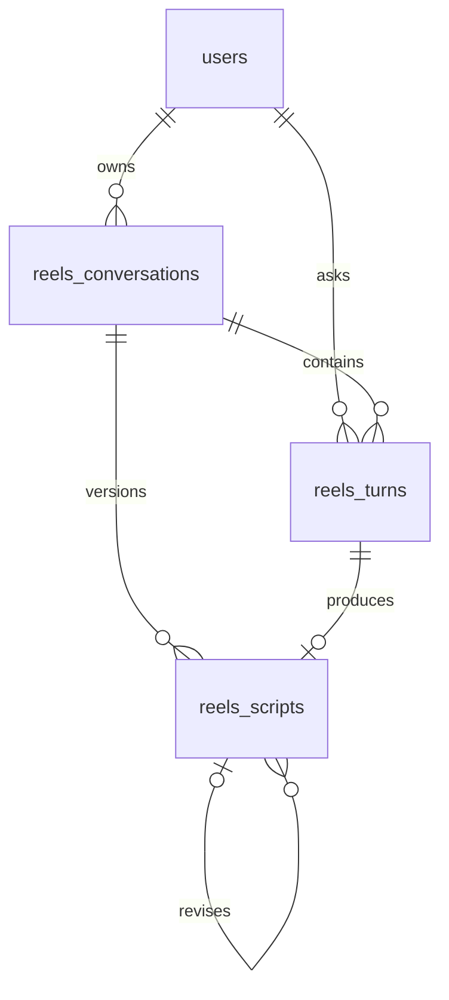

# DB 구조와 확인 방법

내부 모듈은 shortform 이름을 사용한다. 기존 데이터 보존을 위해 물리 테이블 이름 reels_conversations/reels_turns/reels_scripts는 유지하며 서비스 표기는 인스타 릴스로 통일한다. SQLite의 기존 VARCHAR(60) 열은 길이를 강제하지 않아 새 scrypt 문자열도 보관 가능하며 호환성 테스트로 검증한다. 다른 DB로 이전할 경우 열 길이 마이그레이션이 필요하다.

SQLite + SQLAlchemy 2. 사용자·기획 대화·질문/응답·대본 버전을 4개 테이블로 관리한다. 실행 시 create_all로 없는 테이블을 생성한다. 후속 스키마 변경에는 별도 마이그레이션이 필요하다.



| 테이블 | 주요 필드 |
|---|---|
| users | id, email(고유), password_hash(신규 scrypt, 기존 bcrypt 호환), created_at |
| reels_conversations | id, user_id, title, phase, brief_json, version, active_request_id, active_until, created_at, updated_at |
| reels_turns | id, conversation_id, user_id, request_id(고유), action, question, answer(nullable), status, error_code, response_json, created_at |
| reels_scripts | id, conversation_id, turn_id(고유), revision, parent_script_id, brief_json, content_json, references_json, created_at. (conversation_id, revision) 고유 |

phase: briefing / ready / drafted. status: processing / success / timeout / error. AI 실패 턴은 answer=NULL이며 다음 AI 문맥에서 제외한다. 모든 API 조회는 인증된 user_id를 기준으로 필터링한다. DB 이벤트 로그에 질문 본문을 남기지 않지만 질문·답변 자체는 과제 요구에 따라 DB에 저장되므로 DB 파일도 공개 Git에 올리지 않는다.

대화방마다 DB에 처리 표시와 만료를 저장한다. 동일 버전의 동시 요청은 조건부 UPDATE로 하나만 통과시킨다. 프로세스가 중단된 뒤 만료된 처리는 다음 요청에서 회수한다. 마지막 성공 조건과 대본은 유지한다. AI 대기 동안 DB 쓰기 락을 보유하지 않는다.

읽기 전용 확인:

```powershell
uv run --python 3.12 python scripts/check_shortform_logs.py --db app.db --user-id 1
```

본인의 실제 user_id로 변경한다. 결과에 대화방·질문·답변·시각·성공/실패가 포함된다. 파일이 없으면 새 DB를 만들지 않고 오류를 반환한다. DB API 확인은 로그인 후 `/api/me/chats?conversation_id=1`을 사용한다.

운영 DB는 `/srv/shortform-coach-data/app.db` 등 영속 위치를 사용하고 `DATABASE_URL=sqlite:////srv/shortform-coach-data/app.db`로 연결한다. DB 쓰기 경로는 서비스 사용자만 접근하도록 설정한다. 살아 있는 DB를 백업할 때 SQLite backup API를 사용한다. WAL 설정을 추가하면 DB 파일만 복사하는 방식은 사용하지 않는다.
